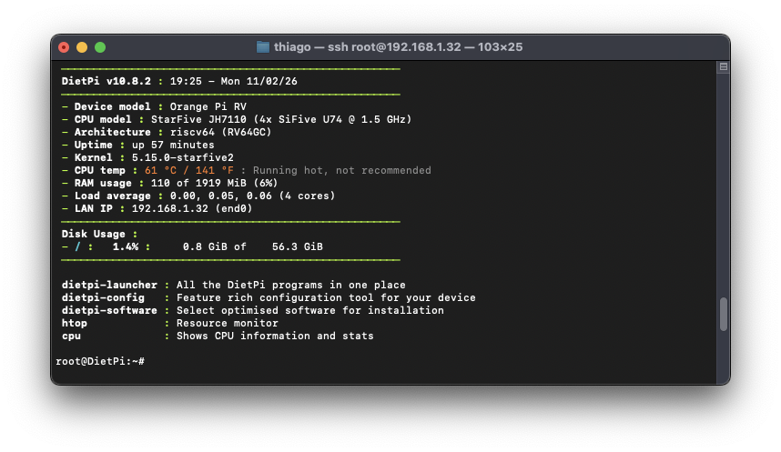
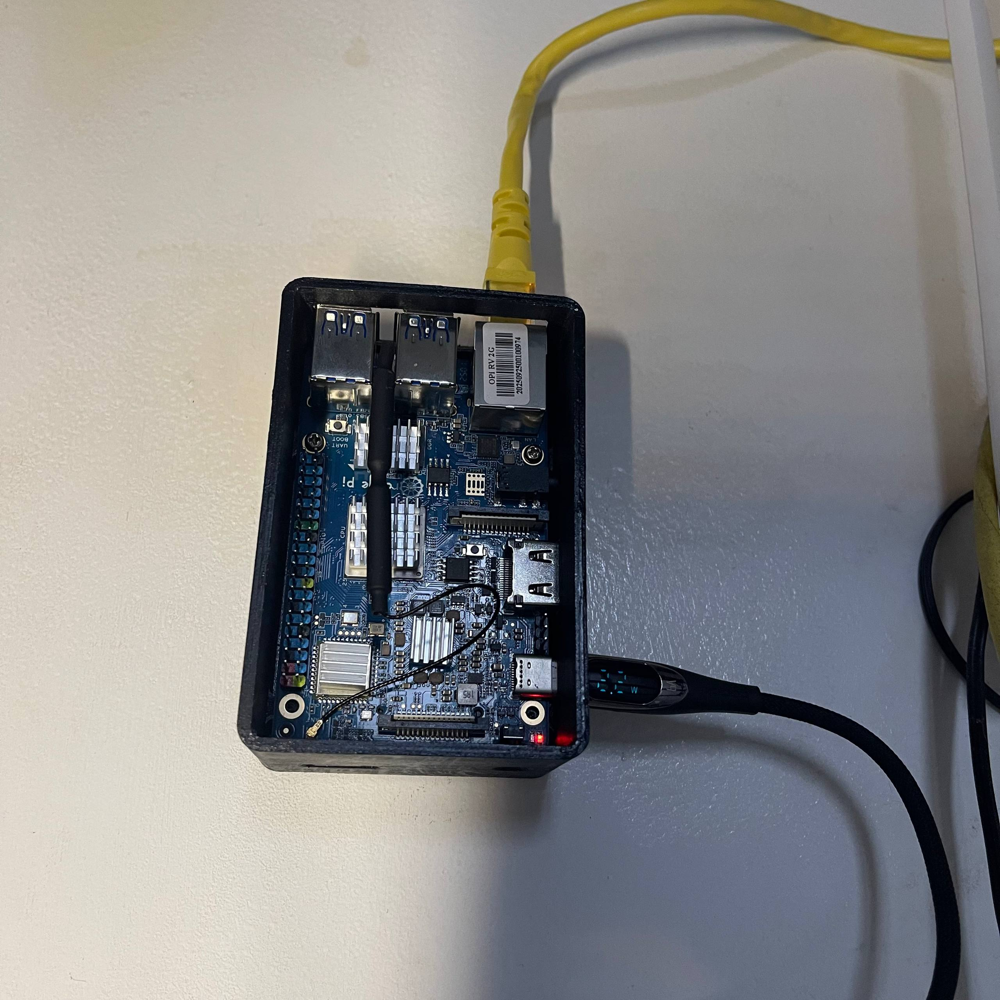

# DietPi for Orange Pi RV 1st generation (StarFive JH7110 / RISC-V)

A lightweight DietPi installation image tailored for the Orange Pi RV single-board computer, built on a minimal Debian 13 (Trixie) base with board-specific kernel support.

---

<table>
  <tr>
    <td align="center" width="50%">
      <br />
      <sub><b>DietPi v10.x running on Orange Pi RV 1st gen (SSH session)</b></sub>
    </td>
    <td align="center" width="50%">
      <br />
      <sub><b>Orange Pi RV 1st gen inside a 3D printed case</b></sub>
    </td>
  </tr>
</table>

---

## Overview

* **Board:** Orange Pi RV
* **SoC / Architecture:** StarFive JH7110 (4x SiFive U74 @ 1.5 GHz, `riscv64` / RV64GC)
* **OS Base:** Debian 13 (Trixie) minimal with DietPi
* **Kernel:** `5.15.0-starfive2` (held with `apt-mark hold` to protect bootloader, GPU HDMI clocks, and peripheral device-tree bindings)
* **Footprint:** ~0.8 GiB disk usage out of the box, around 110 MiB idle RAM usage

---

## Default Credentials

* **Root user:**
  * Username: `root`
  * Password: `dietpi`
* **Default user:**
  * Username: `dietpi`
  * Password: `dietpi`

> You will be asked to change these default passwords during the first boot setup.

---

## Requirements

* Orange Pi RV board
* MicroSD card (8 GB or larger recommended, Class 10 / A1 or faster)
* NVMe SSD is supported and recommended for heavy storage workloads
* 5V USB-C power supply (at least 3A recommended)
* Ethernet cable connected to your local network (for headless setup)

---

## How to Flash the Image

1. **Download the image archive:**
   * Download `DietPi_OrangePiRV-RISCV64-Trixie.img.xz` and extract it to obtain the `.img` file.
   * Verify the checksum if provided:
     ```bash
     shasum -a 256 DietPi_OrangePiRV-RISCV64-Trixie.img.xz
     ```

2. **Write to your microSD card:**
   * **Raspberry Pi Imager:** Select *Choose OS* -> *Use custom*, choose the extracted `.img` file, select your SD card, and click *Write*.
   * **BalenaEtcher:** Select *Flash from file*, pick the image, select the target SD card, and click *Flash!*.
   * **dd (Linux / macOS):**
     ```bash
     sudo dd if=DietPi_OrangePiRV-RISCV64-Trixie.img of=/dev/sdX bs=4M status=progress conv=fsync
     ```
     *(Replace `/dev/sdX` with your actual microSD block device).*

3. **Eject safely:**
   * Always safely eject/unmount the SD card before removing it from your computer.

---

## First Boot & Setup

1. **Power on:**
   * Insert the card into your Orange Pi RV.
   * Connect an Ethernet cable to your router or switch.
   * Plug in the 5V power supply.

2. **Wait for initial setup:**
   * On first boot, the system automatically expands the root filesystem to fill your entire SD card, initializes fresh SSH host keys, and restarts core services.
   * Give the board about 1 to 2 minutes to complete this initial run.

3. **Find the IP address:**
   * Check your router's DHCP client list for a device named `DietPi` or look for its MAC address.
   * If you have an HDMI monitor attached, the IP address is displayed directly in the console screen.

4. **Connect via SSH:**
   * Open a terminal on your computer and connect:
     ```bash
     ssh root@<YOUR_BOARD_IP>
     ```
   * Accept the host fingerprint when prompted (`yes`) and enter the default password: `dietpi`.
   * Follow the DietPi first-run wizard on screen to set your new passwords and system preferences.

---

## Security Hardening & CVE Mitigations (Without Kernel Recompilation)

Due to vendor-specific HDMI pixel clocking, device tree bindings (DTB), and U-Boot memory layouts, custom kernel recompilations can easily destabilize video output and display timings. Fortunately, known kernel vulnerabilities can be effectively mitigated directly from userspace without modifying or replacing the factory BSP kernel:

### 1. Disable RxRPC Protocol (Fragnesia / Dirty Frag Mitigations)
The RxRPC network protocol family contains legacy fragmentation handling code that is unnecessary for general SBC operations. Prevent the module from ever being loaded into memory:

```bash
echo "blacklist rxrpc" | sudo tee /etc/modprobe.d/blacklist-rxrpc.conf
echo "install rxrpc /bin/true" | sudo tee -a /etc/modprobe.d/blacklist-rxrpc.conf
```

Verify that the module is not loaded:
```bash
lsmod | grep rxrpc
```

### 2. Restrict Unprivileged Socket Interfaces & Namespaces (Copy Fail Mitigation)
Vulnerabilities targeting exposed kernel crypto interfaces (`CONFIG_CRYPTO_USER_API_*`) typically require unprivileged users to create network namespaces or bind arbitrary netlink sockets:

```bash
sudo tee /etc/sysctl.d/99-security-hardening.conf << 'EOF'
# Restrict unprivileged user namespace creation (cuts off common exploit chains)
kernel.unprivileged_userns_clone = 0

# Restrict dmesg inspection to root
kernel.dmesg_restrict = 1

# Disable TCP request socket migration if not explicitly needed
net.ipv4.tcp_migrate_req = 0
EOF

sudo sysctl --system
```

### 3. Mitigating TCP Race Conditions (CVE-2026-98432)
* **NAT / Firewall Protection:** The TCP option handling race condition occurs on unacknowledged SYN-ACK handshakes under rapid concurrent retransmissions. Operating the board behind standard NAT routers or using `nftables`/`iptables` to drop invalid TCP connection states effectively shields the network stack:
  ```bash
  sudo iptables -A INPUT -m conntrack --ctstate INVALID -j DROP
  ```
* **Headless Deployment:** If running node relays (like Tor Snowflake) or internal network microservices, keeping the stock kernel with the hardening rules above ensures maximum hardware stability while removing the attack surface.

---

## Troubleshooting & Storage Expansion

The image includes an automated first-boot service that expands the partition and filesystem to match your storage media. If your root filesystem still shows around `1.4 GiB` after logging in (`df -h /`), you can manually trigger the expansion:

```bash
sudo /usr/local/bin/growpart /dev/mmcblk1 2
sudo resize2fs /dev/mmcblk1p2
```

Verify the expanded capacity:
```bash
df -h /
```

---

## Important Hardware & Kernel Notes

* **Do not unhold the kernel packages:**
  * The custom vendor BSP kernel (`5.15.0-starfive2`) is locked via `apt-mark hold`.
  * Standard Debian upstream kernels do not yet carry full peripheral and device-tree support for the Orange Pi RV bootloader. Running a blind kernel upgrade from Debian repositories will break your board's ability to boot.
  * You can safely run `apt update` and `apt upgrade` for regular system packages.

* **Cooling:**
  * The JH7110 SoC runs warm (typically 45 °C to 65 °C depending on ambient temperature and workload). A passive heatsink and a 5V fan are strongly recommended for sustained multi-core tasks.

* **Software management:**
  * Use the built-in `dietpi-software` tool anytime to install lightweight packages (Docker, Pi-hole, web servers, databases, etc.) optimized for your setup.
